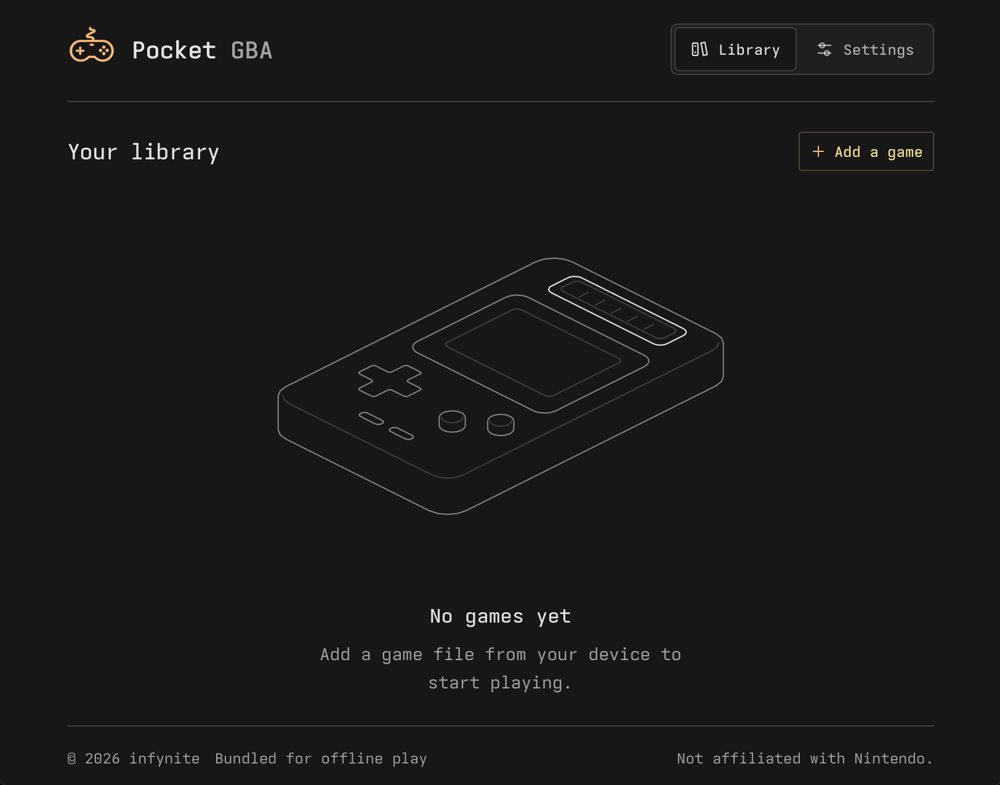

# Pocket GBA

For when "I'll just play until the next save point" turns into an evening.

Pocket GBA plays your Game Boy Advance games in a browser or on your desktop.
Bring your own games; keep them in a local library. Use a keyboard or touch
controls, make save states before questionable decisions, and turn on cheats
when you've suffered enough. Offline play, too.

No account to make. No games to upload. Just pick something and play.



## Press Start

Requires **Node 22.19+** and **pnpm 12**.

```sh
pnpm install
pnpm fetch-emulator
pnpm dev
```

Open **http://localhost:5173**, add a `.gba` file or a ZIP containing one game,
and there goes your afternoon. The emulator download doesn't include games.

## Commands

| Command              | What it does              |
| -------------------- | ------------------------- |
| `pnpm build`         | Build the web app         |
| `pnpm preview`       | Preview the web build     |
| `pnpm desktop:dev`   | Run the desktop app       |
| `pnpm desktop:build` | Build a desktop installer |
| `pnpm test`          | Run unit tests            |
| `pnpm lint`          | Check code quality        |

Desktop uses **Tauri 2** and requires Rust and
[platform tools](https://v2.tauri.app/start/prerequisites/).

## Taking it to the desktop

Want a standalone app? Public GitHub Releases can distribute macOS `.dmg`,
Windows `.exe`, and Linux `.AppImage` / `.deb` installers without paid signing
certificates.

The catch: unsigned macOS and Windows builds may trigger security warnings or be blocked.

App updates need a **free cryptographic signing key**, which is separate from
optional Apple/Windows signing. They also need your consent and a successful save
before installation. Nobody wants an updater eating their boss fight.

See [release and updater setup](docs/updates.md); updates aren't live until
configured and tested.

## Before you get comfortable

- **Going offline?** Wait for **Ready offline** in the web app before disappearing.
  Test this with a production build, not `pnpm dev`.
- **Playing on your phone?** Open the HTTPS site and add it to your home screen.
- **Attached to your save file?** Keep external backups. Browser and desktop data
  are separate, so don't expect your progress to follow you between them.
- **Trying a cheat?** Reopen the game for changes to take effect. We won't judge.

## Buy me an extra life

[Sponsor my work](https://github.com/sponsors/tech-savvy-guy) to keep Pocket GBA
going. No cheat code for rent, unfortunately.

## The small print

Bring your own legally obtained games. No ROMs or BIOS are bundled.
Not affiliated with Nintendo.

Powered by EmulatorJS (GPL-3.0) and mGBA. Redistribution must comply with their
licenses and corresponding-source requirements.
